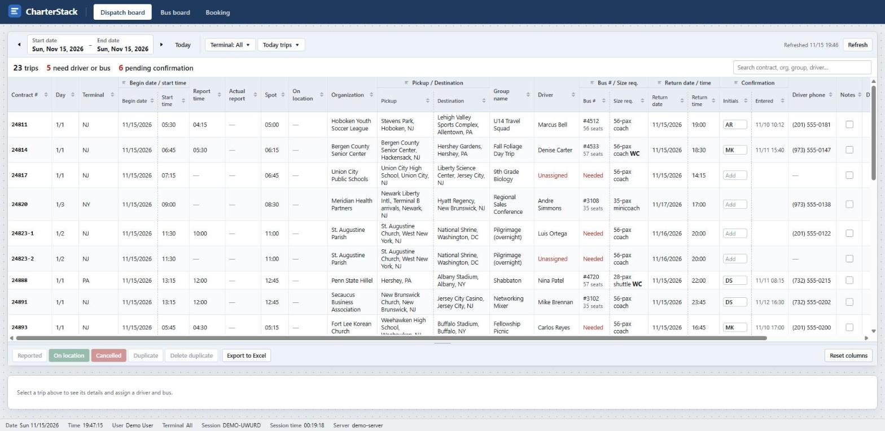
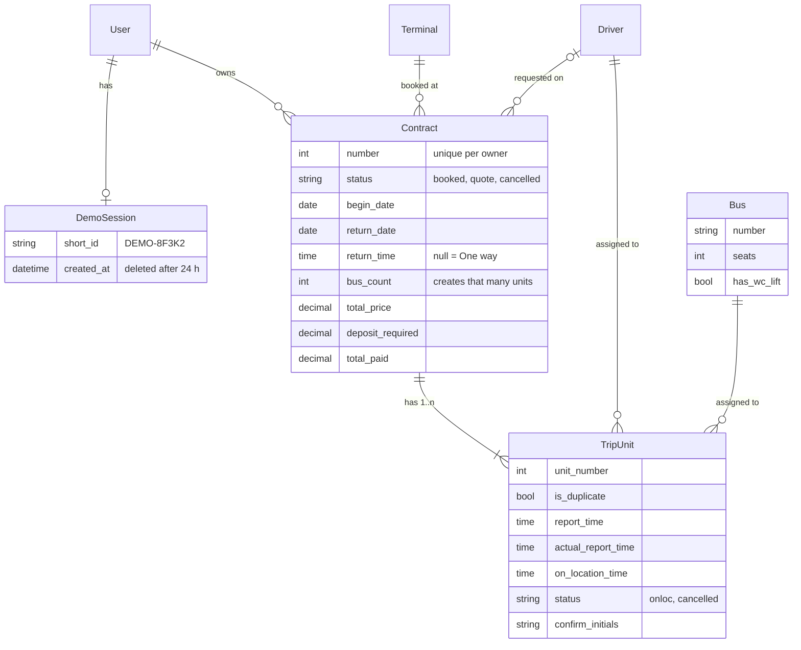
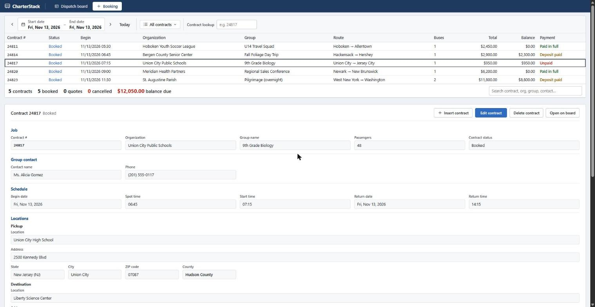
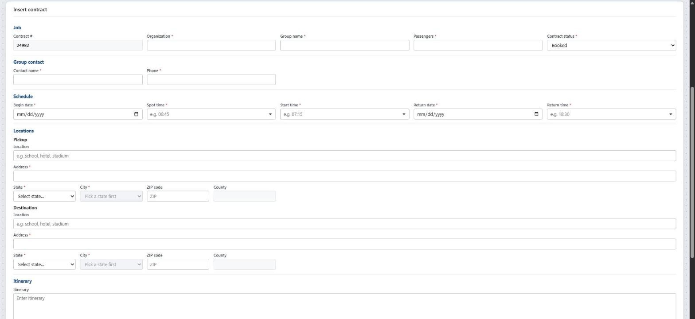

# CharterStack

A dispatch board and booking system for a motorcoach charter company, built with Django REST Framework and React.

**Live demo:** _add link after deploy_ — click **Try the demo**. No sign-up; you get a private copy of the sample data.



## Why I built this

I started as a dispatcher and now work as a logistics planner in the motorcoach charter business, matching trips, buses and drivers every day. That work runs on a booking system and a dispatch board: which trips go out, who is driving, which bus, when the driver reports, whether the trip is confirmed. CharterStack is my version of that tool, built to show how I turn real operations into software.

## What it does

**Booking** — sales creates charter contracts.
- Insert, edit, view and delete contracts: group, contact, schedule, pickup and destination, itinerary, vehicles, pricing.
- Contract status: Quote, Booked, Cancelled. Balance due and payment status are computed.
- Contract list by date range, with status filter, search and lookup.

**Dispatch board** — dispatch works the day's trips.
- One row per bus. A two-bus contract shows as `24823-1` and `24823-2`.
- Assign driver, bus and report time, with warnings when the bus is too small or has no wheelchair lift.
- Stamp Reported and On location times, cancel, add confirmation initials and dispatch notes.
- Filter by date range, terminal, and today / away / all trips. Search, sort, resize and reorder columns.
- Export the current view to Excel.

Quotes never reach the board; cancelled contracts stay visible in red.

## How the demo works

Clicking **Try the demo** creates a temporary user and copies the sample data for that user only. Every database query is scoped to the logged-in user, so visitors never see each other's changes. Sandboxes are deleted after 24 hours. Details: [docs/DEMO_SANDBOX.md](docs/DEMO_SANDBOX.md).

## Tech stack

| | |
|---|---|
| Backend | Python, Django, Django REST Framework, PostgreSQL |
| Frontend | React, TypeScript, Vite, TanStack Query |
| Testing | pytest, Vitest, GitHub Actions |
| API docs | OpenAPI / Swagger at `/api/docs/` |

## Data model



A **Contract** is what sales books. A **TripUnit** is one bus on that contract and one row on the dispatch board. Full details: [docs/DATA_MODEL.md](docs/DATA_MODEL.md).

## How it's built

- **Every visitor gets a private sandbox.** A base viewset, `OwnedModelViewSet`, filters every query by the logged-in user and sets the owner on create, so isolation is written once, not per view. Another visitor's row returns 404, never 403. A dedicated test suite tries every endpoint against someone else's IDs.
- **Business rules live in Django.** Balance due, payment status, unit display numbers, day labels, counts, warnings and time parsing are computed by the API and tested with pytest, one test per rule ID. React only displays what the API returns; even the form's live "Balance due" comes from a pricing endpoint.
- **Trips are split into units.** Booking sees one contract; dispatch needs one row per bus with its own driver, bus and times. A `TripUnit` per bus makes multi-bus contracts and duplicates a data fact instead of UI logic.
- **Times are 24-hour everywhere.** The API accepts loose typing (`730`, `7p`, `ow`) and always answers `HH:MM`.

Project layout:

```
backend/    Django project (config) and the charters app: models, services, board, API, tests
frontend/   React + TypeScript (Vite): api/, board/, booking/, components/, lib/
docs/       spec, rules, API, data model, UI guide, screenshots
seed/       sample data copied into each sandbox
Dockerfile  one image: builds the frontend, then serves it from Django with WhiteNoise
render.yaml Render blueprint: web service, daily cleanup cron, PostgreSQL
```

## Run it locally

Requirements: [uv](https://docs.astral.sh/uv/) (installs Python 3.12 for you) and Node.js 22 or newer.

```bash
# backend (first terminal)
cd backend
uv sync                                  # creates .venv with Python 3.12 + dependencies
uv run python manage.py migrate
uv run python manage.py seed_reference   # terminals, drivers, buses, ZIP codes (safe to re-run)
uv run python manage.py createsuperuser  # optional: to browse reference data at /admin/
uv run python manage.py runserver        # API on http://localhost:8000
uv run python manage.py cleanup_demo     # deletes demo sandboxes older than 24 h (daily cron in production)

# frontend (second terminal)
cd frontend
npm install
npm run dev                              # app on http://localhost:5173, proxies /api to :8000
```

Open http://localhost:5173. Health check: http://localhost:8000/api/health/. API docs: http://localhost:8000/api/docs/.

Local development uses SQLite with no setup. To use PostgreSQL, set `DATABASE_URL` (see [backend/.env.example](backend/.env.example)).

## Deploy

The app ships as one Docker image: the React build is served by Django (WhiteNoise) behind gunicorn, so the site and the API share an origin and the session cookie just works. On start the container runs migrations, loads reference data and creates or updates the admin user, then starts gunicorn (`backend/bin/start.sh`).

On [Render](https://render.com):
1. Push the repo to GitHub, then in Render choose **New → Blueprint** and pick the repo. `render.yaml` creates the web service, a PostgreSQL database and a daily `cleanup_demo` cron job, all on fixed-price plans with one instance.
2. When asked, set `DJANGO_SUPERUSER_USERNAME`, `DJANGO_SUPERUSER_PASSWORD` and `DJANGO_SUPERUSER_EMAIL`. That account is the only way into `/admin/`.
3. Open the service URL and click **Try the demo**.

Environment variables: see [backend/.env.example](backend/.env.example). `SECRET_KEY` is generated by Render; `RENDER_EXTERNAL_HOSTNAME` is added to the allowed hosts automatically.

To try the production image locally:

```bash
docker build -t charterstack .
docker run -p 8000:8000 -e SECRET_KEY=local -e DEBUG=false -e SECURE_SSL_REDIRECT=false   -e ALLOWED_HOSTS=localhost -e DATABASE_URL=sqlite:////tmp/db.sqlite3 charterstack
```

CI builds this image on every push and checks that it serves the health check, the app and the admin.

## Tests

```bash
cd backend && uv run pytest
cd backend && uv run ruff check . && uv run ruff format --check .
cd frontend && npm test && npm run lint && npm run build
```

GitHub Actions runs all of these on every push, with the backend tests against PostgreSQL.

Every business rule in [docs/BUSINESS_RULES.md](docs/BUSINESS_RULES.md) has a named test, and sandbox isolation has its own test suite.

## Documentation

- [Product spec](docs/SPEC.md)
- [UI guide](docs/UI_GUIDE.md)
- [Data model](docs/DATA_MODEL.md)
- [Business rules](docs/BUSINESS_RULES.md)
- [API](docs/API.md)
- [Demo sandbox](docs/DEMO_SANDBOX.md)
- [Build plan](docs/BUILD_PLAN.md)

## Screenshots

| Booking: contract view | Booking: contract form |
|---|---|
|  |  |

## Author

Anthony Rivera · [anthonydanrivera.com](https://anthonydanrivera.com)
