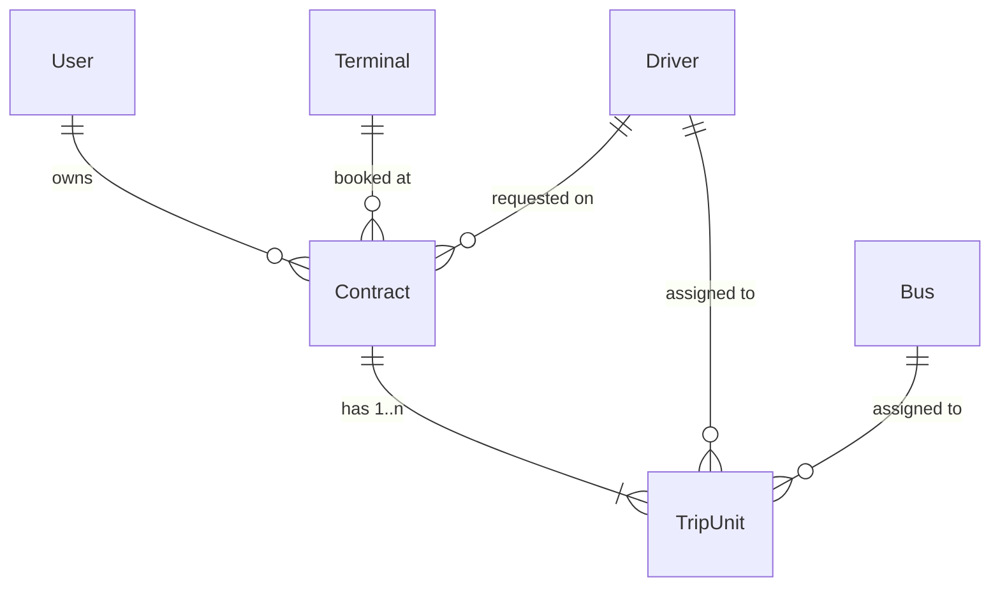

# Data Model

All models live in one Django app, `charters`. Every visitor-owned model has an `owner` foreign key to the demo user (see `DEMO_SANDBOX.md`). Reference data is global and read-only to visitors.

## Reference data (global, managed in Django admin)

### Terminal
| Field | Type | Notes |
|---|---|---|
| `code` | CharField(2), unique | `NJ`, `NY`, `PA`, `CT`, `MA` |
| `name` | CharField | `New Jersey`, `New York`, `Pennsylvania`, `Connecticut`, `Massachusetts` |

### Driver
| Field | Type | Notes |
|---|---|---|
| `name` | CharField, unique | |
| `phone` | CharField | Display format `(201) 555-0101` |
| `is_active` | BooleanField, default True | Inactive drivers are hidden from dropdowns |

### Bus
| Field | Type | Notes |
|---|---|---|
| `number` | CharField, unique | `4512`. Displayed as `#4512` |
| `seats` | PositiveSmallIntegerField | 28, 35, 56 or 57 in the sample data |
| `model` | CharField | `MCI J4500` |
| `has_wc_lift` | BooleanField, default False | 4533 in the test seed; one coach per terminal plus a few smaller buses in the demo seed |
| `terminal` | FK → Terminal, null | Home terminal (yard). Groups buses on the Bus board (R34). Null = not assigned to a yard |
| `is_active` | BooleanField, default True | |

### ZipCode (optional table; a JSON constant is also acceptable)
`zip` → `city`, `state`, `county`. Used to auto-fill city, state and county in the booking form. The 41 sample ZIPs are in `seed/seed_demo.json` under `zip_lookup`.

## Visitor-owned data

### Contract
One charter booking. Shown in Booking. Never shown directly on the board; its trip units are.

| Field | Type | Notes |
|---|---|---|
| `owner` | FK → User, on_delete CASCADE | Sandbox scope. Indexed. |
| `number` | PositiveIntegerField | 5 digits, assigned by the server: max existing number for this owner + 1 (sample data starts at 24811). Unique per owner. Never typed by the user. |
| `status` | CharField choices | `booked` (default), `quote`, `cancelled` |
| `organization` | CharField(80) | Required |
| `group_name` | CharField(80) | Required |
| `passengers` | PositiveSmallIntegerField | Required, at least 1 |
| `contact_name` | CharField(80) | Required |
| `contact_phone` | CharField(30) | Required |
| `begin_date` | DateField | Required |
| `spot_time` | TimeField | Required. When the bus must be at the pickup. |
| `start_time` | TimeField | Required. When the trip departs. |
| `return_date` | DateField | Required. Must be on or after `begin_date`. |
| `return_time` | TimeField, null | Null means **One way**. |
| `pickup_location` | CharField(120), blank | Place name, e.g. "Union City High School". Optional. |
| `pickup_address` | CharField(120) | Street address. Required. |
| `pickup_city`, `pickup_state`, `pickup_zip` | CharField | City and state required; ZIP optional but auto-fills the others |
| `pickup_county` | CharField, blank | Filled from the ZIP lookup; read-only in the form |
| `dest_location`, `dest_address`, `dest_city`, `dest_state`, `dest_zip`, `dest_county` | same as pickup | |
| `itinerary` | TextField, blank | Free text, one stop per line |
| `bus_count` | PositiveSmallIntegerField, default 1 | Required, at least 1. No upper limit on the number of buses. |
| `terminal` | FK → Terminal | Required |
| `size_requirement` | CharField choices | One of the 8 size options below |
| `requested_driver` | FK → Driver, null | Optional |
| `info` | TextField, blank | Special instructions shown to dispatch |
| `total_price` | DecimalField(10,2) | Required, 0 or more |
| `deposit_required` | DecimalField(10,2), default 0 | Must not exceed `total_price` |
| `total_paid` | DecimalField(10,2), default 0 | Everything received so far, including the deposit |
| `created_at`, `updated_at` | DateTimeField | auto |

Size options: `56-pax coach`, `56-pax coach WC`, `57-pax coach`, `57-pax coach WC`, `35-pax minicoach`, `35-pax minicoach WC`, `28-pax shuttle`, `28-pax shuttle WC`. A size ending in `WC` means the trip needs a wheelchair lift.

Computed (properties or serializer fields, never stored): `balance_due`, `payment_status`, `needs_wc`, `is_multi_day`. See `BUSINESS_RULES.md`.

### TripUnit
One bus on one contract. **This is a row on the dispatch board.** A contract with `bus_count = 2` has two regular units. Dispatch can also add duplicate units.

| Field | Type | Notes |
|---|---|---|
| `owner` | FK → User, on_delete CASCADE | Same owner as the contract. Indexed. |
| `contract` | FK → Contract, on_delete CASCADE, related_name `units` | |
| `unit_number` | PositiveSmallIntegerField | 1..bus_count for regular units; 1..n for duplicates |
| `is_duplicate` | BooleanField, default False | Duplicates are created from the board and are not counted in `bus_count` |
| `driver` | FK → Driver, null | |
| `bus` | FK → Bus, null | |
| `report_time` | TimeField, null | Planned driver report time, set by dispatch |
| `actual_report_time` | TimeField, null | Stamped by the Reported button |
| `on_location_time` | TimeField, null | Stamped by the On location button |
| `status` | CharField choices, blank | `""` (normal), `onloc`, `cancelled` |
| `confirm_initials` | CharField(4), blank | Dispatcher initials |
| `confirmed_at` | DateTimeField, null | Set by the server when initials are entered |
| `dispatch_notes` | TextField, blank | |

Unique together: (`contract`, `is_duplicate`, `unit_number`).

Display number (computed):
- Single-bus contract, regular unit: `24817`
- Multi-bus contract, regular unit: `24823-1`, `24823-2`
- Duplicate: `24817-D1`, `24817-D2`

### Why units instead of trips on the contract
Booking sees one contract. Dispatch needs one row per bus, each with its own driver, bus, report time, status and confirmation. Splitting dispatch fields onto `TripUnit` keeps both views simple and makes the multi-bus rule a data fact, not UI logic.

## Indexes
- `Contract(owner, begin_date)`, `Contract(owner, number)`
- `TripUnit(owner, contract)`

## Migrations and seed
- A data migration (or the `seed_reference` command) loads terminals, drivers, buses and ZIP codes from `seed/seed_demo.json`.
- Contracts are never loaded globally. They are copied into each new sandbox at demo login.
